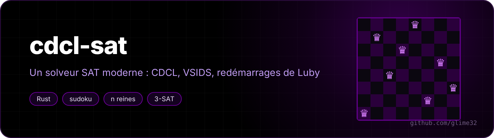

<p align="center"></p>

<p align="center"> </p>

Un solveur SAT en Rust, sans dépendance. On lui donne une formule logique en forme normale conjonctive (« (a ou non b) et (b ou c) et ... ») et il trouve une affectation qui la rend vraie, ou prouve qu'il n'y en a pas.

<p align="center"><a href="README.md">🇬🇧 English version</a></p>

C'est un solveur **CDCL** (*conflict-driven clause learning*), la technique derrière MiniSat, Glucose, CaDiCaL : à chaque impasse il apprend une nouvelle clause qui l'empêche de refaire la même erreur.

```
$ cargo build --release
$ ./target/release/cdcl sudoku "8..........36......7..9.2...5...7.......457.....1...3...1....68..85...1..9....4.."
8 1 2 | 7 5 3 | 6 4 9
9 4 3 | 6 8 2 | 1 7 5
6 7 5 | 4 9 1 | 2 8 3
------+-------+------
1 5 4 | 2 3 7 | 8 9 6
3 6 9 | 8 4 5 | 7 2 1
2 8 7 | 1 6 9 | 5 3 4
------+-------+------
5 2 1 | 9 7 4 | 3 6 8
4 3 8 | 5 2 6 | 9 1 7
7 9 6 | 3 1 8 | 4 5 2
c 0.001 s, 18 conflits, 30 décisions, ...
```

(La grille d'Arto Inkala, présentée en 2012 comme « le sudoku le plus dur du monde ». 729 variables, 12 009 clauses, 18 conflits.)

## Utilisation

```
cdcl fichier.cnf              format DIMACS, comme les compétitions SAT (codes de sortie 10 / 20)
cdcl sudoku GRILLE
cdcl reines N
cdcl pigeons N                N+1 pigeons dans N trous
cdcl aleatoire N RATIO        3-SAT aléatoire
cdcl transition [N] [ESSAIS]
cdcl genere sudoku|reines|pigeons|aleatoire ...  > probleme.cnf
```

Quand il répond « satisfiable », le modèle est revérifié clause par clause avant d'être affiché.

## La transition de phase

Des clauses de 3 littéraux tirées au hasard : avec peu de clauses par variable, presque tout est satisfiable ; avec beaucoup, presque rien. Le basculement est brutal, autour de **4,26**, et c'est exactement là que les problèmes sont les plus durs :

```
$ ./target/release/cdcl transition 120 30
 ratio   SAT    conflits (médiane)
 3.00   100 % ████████████████████       4 ▒▒▒
 3.50   100 % ████████████████████      27 ▒▒▒▒▒▒▒
 4.00    93 % ██████████████████       237 ▒▒▒▒▒▒▒▒▒▒▒
 4.25    46 % █████████                852 ▒▒▒▒▒▒▒▒▒▒▒▒▒▒
 4.50    26 % █████                    750 ▒▒▒▒▒▒▒▒▒▒▒▒▒▒
 5.00     0 %                          435 ▒▒▒▒▒▒▒▒▒▒▒▒▒
 6.00     0 %                          240 ▒▒▒▒▒▒▒▒▒▒▒
```

## Les pigeons

`cdcl pigeons N` demande de ranger N+1 pigeons dans N trous, un par trou. C'est évidemment impossible, mais Haken a montré en 1985 que toute preuve par résolution (ce que fait un CDCL, au fond) est de taille exponentielle. On le voit bien : 9 trous demandent déjà quelques centaines de milliers de conflits.

## Ce qu'il y a dedans

- **Deux littéraux surveillés** par clause : une clause n'est regardée que quand l'un de ses deux littéraux surveillés devient faux. Chaque surveillance garde un « bloqueur », un autre littéral de la clause : s'il est vrai, inutile même de lire la clause. Pour une clause binaire, le bloqueur *est* l'autre littéral, donc on ne la lit jamais.
- **Analyse de conflit 1-UIP** : on remonte les raisons du conflit jusqu'au premier point d'implication unique du dernier niveau, ce qui donne la clause apprise et le niveau où revenir (*backjumping*).
- **Minimisation récursive** de la clause apprise : un littéral saute si tout ce qui l'a impliqué est déjà dans la clause.
- **VSIDS** : chaque variable impliquée dans un conflit gagne de l'« activité », et on branche sur la plus active (tas binaire indexé). Les activités s'estompent en augmentant l'incrément de 5 % à chaque conflit.
- **Sauvegarde de phase** : une variable reprend la dernière valeur qu'elle avait.
- **Redémarrages** selon la suite de Luby (1 1 2 1 1 2 4 ...) × 100 conflits.
- **Oubli** : régulièrement, la moitié des clauses apprises est jetée, en gardant celles de petite **LBD** (nombre de niveaux de décision différents dans la clause, l'idée de Glucose). Les clauses « glue » (LBD ≤ 2) restent toujours.

### Performance

La première version stockait chaque clause dans son propre `Vec`. Ça marchait, mais la propagation passe son temps à sauter de clause en clause, et chaque saut était un défaut de cache. Maintenant toutes les clauses sont dans une seule « arène » (`Vec<u32>` : deux mots d'en-tête puis les littéraux), avec un ramasse-miettes qui la compacte quand la moitié est faite de clauses oubliées. La valeur de chaque *littéral* (et pas seulement de chaque variable) est stockée directement, sans branchement pour le signe.

| | avant | après |
|---|---|---|
| 3-SAT aléatoire, 250 variables, ratio 4,26 | 216 µs / conflit | 20 µs / conflit |
| pigeons 8 | 0,96 s | ~0,35 s |

## Tests

`cargo test` compare le solveur à une recherche exhaustive sur 3000 formules aléatoires (jusqu'à 12 variables et 60 clauses) : même réponse à chaque fois, et chaque modèle trouvé est vérifié.
