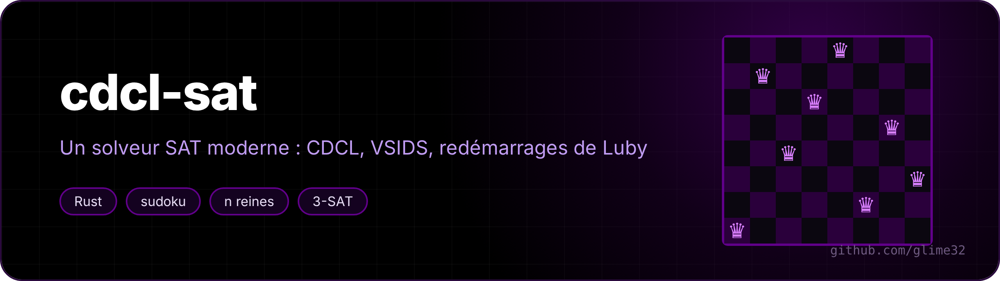

<p align="center"></p>

<p align="center"> </p>

A SAT solver in Rust, with no dependencies. Give it a logic formula in conjunctive normal form ("(a or not b) and (b or c) and ...") and it finds an assignment that makes it true, or proves there isn't one.

<p align="center"><a href="README.fr.md">🇫🇷 Version française</a></p>

It's a **CDCL** solver (*conflict-driven clause learning*), the technique behind MiniSat, Glucose, CaDiCaL: at every dead end it learns a new clause that stops it from making the same mistake again.

```
$ cargo build --release
$ ./target/release/cdcl sudoku "8..........36......7..9.2...5...7.......457.....1...3...1....68..85...1..9....4.."
8 1 2 | 7 5 3 | 6 4 9
9 4 3 | 6 8 2 | 1 7 5
6 7 5 | 4 9 1 | 2 8 3
------+-------+------
1 5 4 | 2 3 7 | 8 9 6
3 6 9 | 8 4 5 | 7 2 1
2 8 7 | 1 6 9 | 5 3 4
------+-------+------
5 2 1 | 9 7 4 | 3 6 8
4 3 8 | 5 2 6 | 9 1 7
7 9 6 | 3 1 8 | 4 5 2
c 0.001 s, 18 conflits, 30 décisions, ...
```

(Arto Inkala's grid, presented in 2012 as "the world's hardest sudoku". 729 variables, 12,009 clauses, 18 conflicts.)

## Usage

Sub-commands are French: `reines` = queens, `pigeons` = pigeonhole, `aleatoire` = random, `genere` = generate.

```
cdcl fichier.cnf              DIMACS format, as in SAT competitions (exit codes 10 / 20)
cdcl sudoku GRILLE
cdcl reines N
cdcl pigeons N                N+1 pigeons in N holes
cdcl aleatoire N RATIO        random 3-SAT
cdcl transition [N] [ESSAIS]
cdcl genere sudoku|reines|pigeons|aleatoire ...  > probleme.cnf
```

When it answers "satisfiable", the model is checked again clause by clause before being printed.

## The phase transition

Random 3-literal clauses: with few clauses per variable, almost everything is satisfiable; with many, almost nothing. The switch is sudden, around **4.26**, and that's exactly where the problems are hardest (`conflits` = conflicts):

```
$ ./target/release/cdcl transition 120 30
 ratio   SAT    conflits (médiane)
 3.00   100 % ████████████████████       4 ▒▒▒
 3.50   100 % ████████████████████      27 ▒▒▒▒▒▒▒
 4.00    93 % ██████████████████       237 ▒▒▒▒▒▒▒▒▒▒▒
 4.25    46 % █████████                852 ▒▒▒▒▒▒▒▒▒▒▒▒▒▒
 4.50    26 % █████                    750 ▒▒▒▒▒▒▒▒▒▒▒▒▒▒
 5.00     0 %                          435 ▒▒▒▒▒▒▒▒▒▒▒▒▒
 6.00     0 %                          240 ▒▒▒▒▒▒▒▒▒▒▒
```

## The pigeons

`cdcl pigeons N` asks to put N+1 pigeons into N holes, one per hole. It's obviously impossible, but Haken showed in 1985 that every resolution proof (which is basically what a CDCL does) has exponential size. And it shows: 9 holes already take a few hundred thousand conflicts.

## What's inside

- **Two watched literals** per clause: a clause is only looked at when one of its two watched literals becomes false. Each watch keeps a "blocker", another literal of the clause: if it's true, there's no need to even read the clause. For a binary clause, the blocker *is* the other literal, so it's never read.
- **1-UIP conflict analysis**: the reasons of the conflict are followed back to the first unique implication point of the last level, which gives the learned clause and the level to go back to (*backjumping*).
- **Recursive minimisation** of the learned clause: a literal is dropped if everything that implied it is already in the clause.
- **VSIDS**: each variable involved in a conflict gains "activity", and the solver branches on the most active one (indexed binary heap). Activities fade by raising the increment by 5% at each conflict.
- **Phase saving**: a variable gets back the last value it had.
- **Restarts** following the Luby sequence (1 1 2 1 1 2 4 ...) × 100 conflicts.
- **Clause deletion**: regularly, half of the learned clauses are thrown away, keeping those with a small **LBD** (number of distinct decision levels in the clause, Glucose's idea). "Glue" clauses (LBD ≤ 2) are always kept.

### Performance

The first version stored each clause in its own `Vec`. It worked, but propagation spends its time jumping from clause to clause, and every jump was a cache miss. Now all clauses live in a single "arena" (`Vec<u32>`: two header words, then the literals), with a garbage collector that compacts it when half of it is deleted clauses. The value of each *literal* (not just each variable) is stored directly, with no branch for the sign.

| | before | after |
|---|---|---|
| random 3-SAT, 250 variables, ratio 4.26 | 216 µs / conflict | 20 µs / conflict |
| pigeons 8 | 0.96 s | ~0.35 s |

## Tests

`cargo test` compares the solver with a brute-force search on 3000 random formulas (up to 12 variables and 60 clauses): same answer every time, and every model found is checked.
